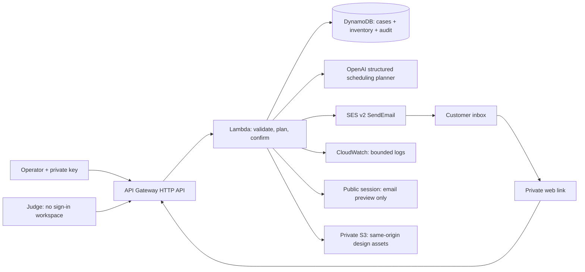
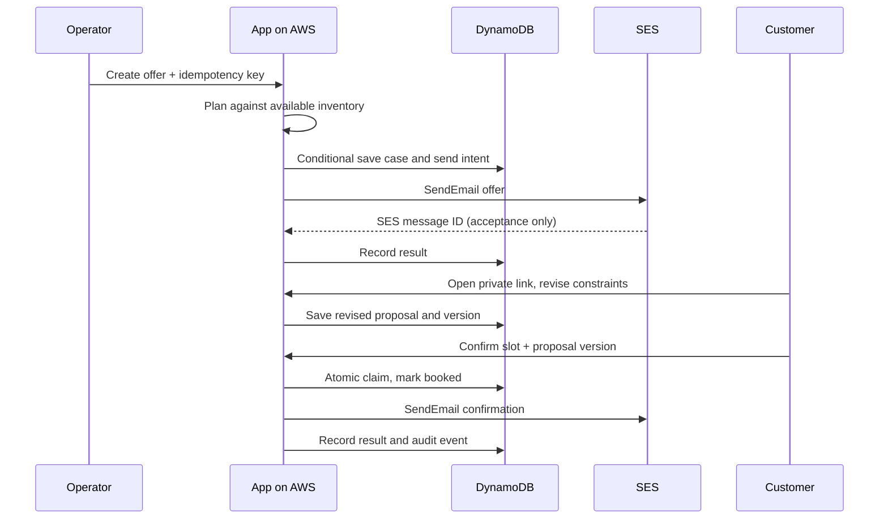

# Architecture

The LLM proposes only a slot identifier and a reason. The application checks that the identifier is currently available; the customer sees the actual date and full time window and must explicitly confirm. The LLM has no email, database or booking credentials. Model-generated content is rendered as text. Invalid JSON fails closed; unavailable slots become clarification requests. Rehearsal mode is a fixture planner, not AI.

Consistency: each public session has a separate versioned record and fresh inventory. Original operator cases share the existing operator record. Compare-and-swap rejects concurrent writes within a record. This trades throughput for simple correctness at hackathon scale. The state is capped below DynamoDB's item limit. Concurrent customers cannot claim the same slot. Slot proposals are not reservations.

Public access: a server-signed 24-hour session isolates the judge workspace. It reuses the planner and booking service but returns email previews unconditionally; it cannot invoke SES. A daily quota record reserves each planner call before inference (150/day), with 80 starts/day and 8 messages/session. Public records have a seven-day TTL. See [public workspace](PUBLIC-WORKSPACE.md).

Delivery: persist SENDING_OR_UNKNOWN before invoking SES with SDK retries disabled. Persist ACCEPTED_BY_SES plus message ID only after an SDK response. Preserve FAILED_OR_UNKNOWN on an exception. No automatic retries of uncertain sends. Actual delivery/bounce webhooks are not implemented.
